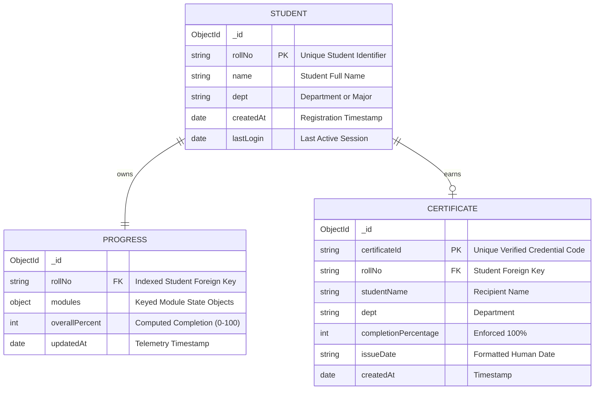
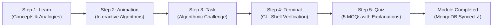
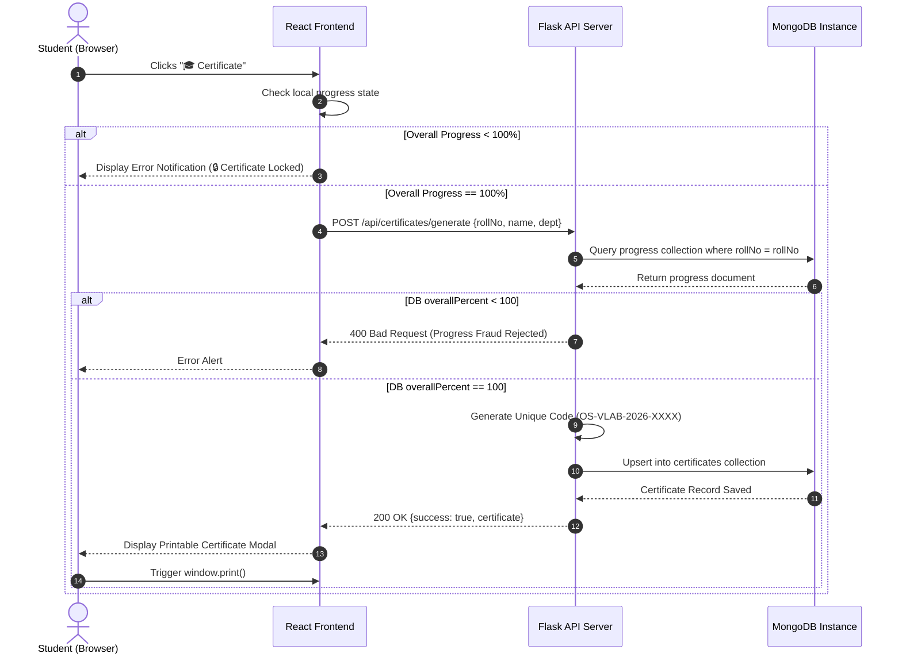

# Project Report: Operating Systems Virtual Laboratory (OS Virtual Lab)

---

## 1. Executive Summary & Abstract

### 1.1 Abstract
The **Operating Systems Virtual Laboratory (OS Virtual Lab)** is a web-based, full-stack educational simulation platform designed to bridge theoretical computer science pedagogy and interactive software engineering. Core operating system mechanisms—such as preemptive CPU dispatching, virtual memory paging, deadlock detection, disk cylinder seeking, and file system block mapping—are abstract and challenging for students to grasp through static textbooks alone. 

This platform delivers an end-to-end interactive learning environment featuring **10 comprehensive modules**. Each module incorporates five integrated learning modalities: **Theoretical Synthesis**, **Deterministic & Dynamic Simulations**, **Algorithmic Problem-Solving Tasks**, an in-browser **Simulated CLI Terminal**, and **Knowledge Assessment Quizzes** (50 questions total). The system is coupled to a **MongoDB** document database via a **Python Flask REST API** service, ensuring per-student state isolation, real-time synchronization, class leaderboard ranking, and verifiable cryptographic completion certificates awarded strictly upon 100% course fulfillment.

### 1.2 Key Highlights
* **10 Interactive Modules:** Process Management, CPU Scheduling, Threads & Concurrency, Process Synchronization, Deadlock Handling, Memory Management, Paging MMU, Page Replacement, Disk Scheduling, and File Allocation.
* **Non-Hardcoded Dynamic Simulations:** Students input arbitrary process burst times, memory partition sizes, reference page strings, and disk cylinder sequences with full playback controls (▶ Play, ⏸ Pause, ⏭ Step Next, ↺ Reset, and ⚡ 0.5x/1x/2x Speed).
* **Multi-Algorithm Dropdowns:** Includes Banker's Safety, RAG Cycle Detection, Wait-For Graphs, FIFO, LRU, Optimal Page Replacement, FCFS, SSTF, SCAN, C-SCAN, LOOK, C-LOOK, Contiguous, Linked, and Indexed (Inode) file allocations.
* **Full-Stack Persistence:** MongoDB database storing student identity records, module-level state trees, and tamper-resistant certificate records.
* **Course Completion Lockout:** Certification pipeline remains strictly locked until an authenticated student achieves 100% mastery across all 50 learning steps.

---

## 2. Problem Statement & Motivation

### 2.1 The Educational Challenge
In undergraduate and graduate Computer Science curricula, Operating Systems is a foundational core course. However, traditional instructional methods encounter distinct friction points:
1. **Dynamic Temporal Complexity:** Understanding how time-sliced Round Robin scheduling operates or how starvation manifests in Priority scheduling requires observing runtime state evolution across discrete time quanta.
2. **Abstract Hardware Abstractions:** Memory Management Units (MMUs), Translation Lookaside Buffers (TLBs), page frame mappings, and disk head motion occur at nanosecond scales within closed hardware layers, rendering direct student observation impossible.
3. **Passive vs. Active Learning Deficit:** Static textbook exercises test memorization rather than algorithmic cause-and-effect reasoning with custom inputs.
4. **Lack of Automated Competency Verification:** Conventional lab work often relies on manual code grading without real-time visualization, verification telemetry, or persistent tracking across lab sessions.

### 2.2 Project Objectives
* Develop a laptop-optimized, bright, accessible single-page web architecture (SPA) that requires no local installation or complex dependencies from the student.
* Provide dynamic parameter manipulation for every major OS algorithm without hardcoded values.
* Deliver deterministic step-by-step visualizations with mathematical derivations rendered concurrently.
* Implement a client-server architecture with MongoDB persistence to isolate student progress, support collaborative class leaderboards, and prevent certificate fraud through server-side verification.

---

## 3. System Architecture & Tech Stack

```
┌─────────────────────────────────────────────────────────────────────────────┐
│                             CLIENT LAYER (BROWSER)                          │
│                                                                             │
│   ┌─────────────────────┐   ┌──────────────────────┐   ┌────────────────┐   │
│   │ React 18 SPA Engine │   │ Tailwind CSS Palette │   │ Lucide Icons   │   │
│   └──────────┬──────────┘   └──────────┬───────────┘   └───────┬────────┘   │
│              │                         │                       │            │
│              ▼                         ▼                       ▼            │
│   ┌─────────────────────────────────────────────────────────────────────┐   │
│   │  Interactive Views: Login, Dashboard, 10 Lab Modules, CLI Shell,    │   │
│   │  Dynamic Simulators, Quiz Modal, Verification Certificate Area      │   │
│   └──────────────────────────────────┬──────────────────────────────────┘   │
└──────────────────────────────────────┼──────────────────────────────────────┘
                                       │ HTTP / JSON REST API
                                       ▼
┌─────────────────────────────────────────────────────────────────────────────┐
│                            BACKEND APPLICATION LAYER                         │
│                                                                             │
│   ┌─────────────────────────────────────────────────────────────────────┐   │
│   │ Python Flask Application Server (app.py : Port 5000)                │   │
│   ├─────────────────────────────────────────────────────────────────────┤   │
│   │  • CORS Headers Middleware           • Static File Serving Router   │   │
│   │  • /api/status                       • /api/students/login          │   │
│   │  • /api/progress/:rollNo             • /api/progress/:rollNo/reset  │   │
│   │  • /api/certificates/generate        • /api/leaderboard             │   │
│   └──────────────────────────────────┬──────────────────────────────────┘   │
└──────────────────────────────────────┼──────────────────────────────────────┘
                                       │ PyMongo Driver (Port 27017)
                                       ▼
┌─────────────────────────────────────────────────────────────────────────────┐
│                            DATABASE STORAGE LAYER                           │
│                                                                             │
│   ┌─────────────────────────────────────────────────────────────────────┐   │
│   │ MongoDB Database: os_virtual_lab                                    │   │
│   ├──────────────────────┬──────────────────────┬───────────────────────┤   │
│   │ Collection: students │ Collection: progress │ Coll: certificates    │   │
│   │ (rollNo, name, dept) │ (rollNo, module map) │ (certId, issueDate)   │   │
│   └──────────────────────┴──────────────────────┴───────────────────────┘   │
└─────────────────────────────────────────────────────────────────────────────┘
```

### 3.1 Technology Stack Details
* **Frontend Runtime:** React 18 (Hooks-based architecture utilizing `useState`, `useEffect`, `useRef`), Babel Standalone parser.
* **Styling Framework:** Tailwind CSS with a vibrant educational light palette (`#fdf6e2` Warm Beige, `#701a75` Deep Burgundy, `#ec4899` Soft Pink, `#059669` Emerald Green, and `#f59e0b` Amber).
* **Typography:** Google Fonts (`Plus Jakarta Sans` for UI, `Outfit` for display headings, `Fira Code` for terminal and algorithmic outputs).
* **Animation & Visual Feedback:** Custom CSS keyframe transitions, Canvas Confetti particle engine.
* **Backend Framework:** Python 3.13 + Flask 3.1, `flask-cors` for cross-origin security headers.
* **Database Driver & Engine:** MongoDB 8.x + `pymongo` 4.19 driver with indexed queries on `rollNo` and `certificateId`.
* **Alternative Deployment Stack:** Node.js Express server (`server.js`) with Mongoose ODM support.

---

## 4. Database Schema & Data Models

The system enforces relational integrity within a schema-less NoSQL paradigm by indexing unique identifiers and maintaining per-student documents.



### 4.1 Progress Schema Breakdown
Each key under `modules` corresponds to an OS topic (`process-management`, `cpu-scheduling`, `threads`, `process-sync`, `deadlocks`, `memory-management`, `paging`, `page-replacement`, `disk-scheduling`, `file-systems`). Every module tracks 5 Boolean checkpoints and an integer quiz score:
```json
{
  "learn": true,
  "animation": true,
  "task": true,
  "terminal": true,
  "quiz": true,
  "completed": true,
  "quizScore": 100
}
```

---

## 5. Detailed Module Breakdown & Algorithm Implementations

Each of the 10 modules incorporates a standardized 5-step curriculum pipeline:

```
[ Step 1: Learn ] ──► [ Step 2: Animation ] ──► [ Step 3: Task ] ──► [ Step 4: Terminal ] ──► [ Step 5: Quiz ] ──► [ Completed ]
```



---

### Module 1: Process Management & Lifecycle
* **Theoretical Foundation:** Process Control Blocks (PCBs), process registers, address space segregation (Text, Data, Heap, Stack), and state transitions.
* **Simulation Mechanics:** Interactive 5-state finite state machine (`New` ➔ `Ready` ➔ `Running` ➔ `Waiting` ➔ `Terminated`). Students trigger events: CPU Dispatch, I/O Interrupt, I/O Completion, and Process Exit.
* **CLI Terminal Commands:** `ps -aux`, `fork`, `kill -9`, `top`.
* **Assessment:** Tests PCB fields, zombie vs. orphan processes, context switch overhead, and fork/exec semantics.

---

### Module 2: CPU Scheduling
* **Algorithms Implemented:**
  1. **FCFS (First-Come, First-Served):** Non-preemptive queue servicing in arrival order.
  2. **SJF (Shortest Job First):** Minimizes mean waiting time by prioritizing the shortest CPU burst.
  3. **Round Robin (RR):** Preemptive scheduling using a student-adjustable Time Quantum ($q$).
  4. **Priority Scheduling:** Static priority ordering with preemption analysis.
* **Mathematical Modeling:**
  $$\text{Turnaround Time (TAT)} = \text{Completion Time} - \text{Arrival Time}$$
  $$\text{Waiting Time (WT)} = \text{Turnaround Time} - \text{Burst Time}$$
  $$\text{Average Waiting Time} = \frac{1}{n} \sum_{i=1}^{n} \text{WT}_i$$
* **Interactive Controls:** Students customize burst times for Process set $\{P_1, P_2, P_3, P_4\}$, execute step-by-step playback, and render the visual Gantt chart with real-time calculated metrics.

---

### Module 3: Threads & Concurrency
* **Theoretical Foundation:** Kernel-level vs. user-level threading models (Many-to-One, One-to-One, Many-to-Many), shared heap and global data vs. isolated thread registers and call stacks.
* **Simulation Mechanics:** Visualization of two concurrent worker threads ($T_1, T_2$) accessing a shared counter variable $X$. Students can execute without synchronization to witness a **Race Condition** ($X=5 \rightarrow 6$), or toggle a **Mutex Lock** to guarantee atomic mutual exclusion ($X=5 \rightarrow 7$).
* **Task Challenge:** Non-deterministic execution interleaving deduction.

---

### Module 4: Process Synchronization
* **Theoretical Foundation:** Critical Section Problem, Mutual Exclusion, Progress, Bounded Waiting, and Semaphore primitives ($\text{wait}() / P()$ and $\text{signal}() / V()$).
* **Classic Problems Simulated:**
  1. **Producer-Consumer Bounded Buffer:** Mutex lock, `empty` semaphore, `full` semaphore monitoring buffer slots.
  2. **Dining Philosophers Problem:** Chandy-Misra / resource hierarchy solution to prevent circular wait deadlocks among 5 philosophers and 5 chopsticks.
* **CLI Terminal Commands:** `sem_init`, `pthread_mutex_lock`, `sync`.

---

### Module 5: Deadlocks
* **Theoretical Foundation:** Coffman Conditions (Mutual Exclusion, Hold and Wait, No Preemption, Circular Wait).
* **Algorithms Implemented in Dropdown Selector:**
  1. **Banker's Safety Algorithm (Avoidance):** Computes $\text{Need} = \text{Max} - \text{Allocation}$ matrix. Verifies if $\text{Need} \le \text{Available}$. Steps through dynamic vectors to verify safe sequences (e.g., $\langle P_1 \rightarrow P_3 \rightarrow P_2 \rangle$).
  2. **Resource Allocation Graph (RAG) Cycle Detection:** Directed graph $G=(V, E)$ cycle analysis where vertices $V = P \cup R$.
  3. **Deadlock Prevention:** Strategies to break Coffman conditions via resource preemption and total resource ordering.
  4. **Wait-For Graph (WFG):** Collapsed process dependency graph for single-instance resource systems.
* **Custom Inputs:** Editable matrices for Allocation, Max Demand, and Available vectors.

---

### Module 6: Memory Management & Dynamic Partitioning
* **Theoretical Foundation:** Contiguous memory allocation, free memory holes, and internal vs. external fragmentation.
* **Allocation Strategies Implemented:**
  1. **First-Fit:** Allocates the first hole that is big enough.
  2. **Best-Fit:** Allocates the smallest hole that is big enough (minimizes wasted leftover space per partition).
  3. **Worst-Fit:** Allocates the largest hole (produces the largest leftover hole).
* **Simulation Mechanics:** RAM layout of 1100 KB total capacity with existing partitions ($100\text{ KB}$, $500\text{ KB}$, $200\text{ KB}$, $300\text{ KB}$). Students input custom process memory requests ($212\text{ KB}$) and visually observe where the block is positioned.

---

### Module 7: Paging & Memory Management Unit (MMU)
* **Theoretical Foundation:** Non-contiguous virtual memory allocation. Logical address translation via hardware page tables and Translation Lookaside Buffers (TLB).
* **Address Translation Mathematical Model:**
  $$\text{Page Number } (p) = \lfloor \text{Logical Address} / \text{Page Size} \rfloor$$
  $$\text{Offset } (d) = \text{Logical Address} \pmod{\text{Page Size}}$$
  $$\text{Physical Address} = (\text{Frame Number } f \times \text{Page Size}) + d$$
* **Interactive Component:** Student enters any decimal byte address (e.g., $2448\text{ B}$). With Page Size $= 1024\text{ B}$, the system decomposes the address into $p = 2, d = 400$, performs a TLB lookup, maps to Frame $f = 5$, and calculates Physical RAM address $5520\text{ B}$.

---

### Module 8: Page Replacement Algorithms
* **Theoretical Foundation:** Virtual memory demand paging, page faults, and frame thrashing.
* **Algorithms Implemented in Dropdown Selector:**
  1. **FIFO (First-In, First-Out):** Replaces the oldest loaded page. Demonstrates Belady's Anomaly where allocating additional frames can increase page faults.
  2. **LRU (Least Recently Used):** Replaces the page that has not been referenced for the longest period of time (stack/counter implementation).
  3. **Optimal (OPT / MIN):** Provably minimal page fault rate algorithm; replaces the page that will not be used for the longest period in the future.
* **Simulation Mechanics:** Dynamic frame slots ($3$ or $4$ frames) evaluated against custom student reference strings (e.g., `7, 0, 1, 2, 0, 3, 0, 4, 2, 3`). Highlights Page Hits vs. Page Faults with complete mathematical tallying.

---

### Module 9: Disk Scheduling
* **Algorithms Implemented in Dropdown Selector:**
  1. **FCFS:** Services I/O cylinder requests in chronological order.
  2. **SSTF (Shortest Seek Time First):** Services requests closest to current head position (prone to starvation).
  3. **SCAN (Elevator Algorithm):** Head sweeps in one direction servicing requests until disk boundary, then reverses.
  4. **C-SCAN (Circular SCAN):** Sweeps in one direction, then immediately jumps back to initial cylinder without servicing on return trip.
  5. **LOOK:** Reverses direction at the last requested cylinder rather than travelling to the disk edge.
  6. **C-LOOK:** Circular variation reversing at the furthest pending cylinder request.
* **Mathematical Calculation:** Total Head Movement (Seek Distance):
  $$\text{Total Cylinders} = \sum_{i=1}^{m} |\text{Track}_i - \text{Track}_{i-1}|$$

---

### Module 10: File Allocation Systems
* **Allocation Methods Implemented in Dropdown Selector:**
  1. **Contiguous Allocation:** File blocks occupy consecutive disk sectors.
     * *Advantage:* Fast direct access ($O(1)$ block retrieval).
     * *Disadvantage:* Severe external fragmentation and fixed file growth limitation.
  2. **Linked Allocation:** Each block contains data and a pointer pointing to the disk sector of the next block.
     * *Advantage:* Zero external fragmentation; dynamic growth.
     * *Disadvantage:* Prohibits random access ($O(n)$ traversal overhead) and vulnerable to pointer corruption.
  3. **Indexed Allocation (UNIX Inode Model):** An Index Block (or Inode) gathers all block pointers into an indexed pointer array.
     * *Advantage:* Direct access supported without external fragmentation.
* **Interactive Visualization:** 16-sector dynamic disk grid. Students change file name and block count ($1$ to $6$ blocks) and observe sector chaining, pointer linkages, and Inode metadata mapping.

---

## 6. Verification & Certification Pipeline

To enforce academic credibility and prevent arbitrary certificate generation, the certification engine implements a dual verification gate:



### 6.1 Print Styling Optimization
The application integrates `@media print` CSS rules that suppress the navigation header, sidebars, dashboard panels, and background DOM elements during printing, outputting only the high-resolution `#certificate-print-area` with official university typography, verification stamp, date, and unique database ID.

---

## 7. User Interface & Accessibility Engineering

### 7.1 Visual Palette & Psychology
Rather than a dark gaming theme, the lab utilizes an academic palette:
* **Canvas Background:** `#fdf6e2` (Warm, non-glare parchment reducing cognitive fatigue).
* **Primary Interactive Accents:** `#701a75` (Deep Academic Burgundy) & `#7e22ce` (Purple).
* **Engagement Signals:** `#ec4899` (Pink highlights) & `#f59e0b` (Amber interactive badges).
* **State Verification:** `#059669` (Emerald Green confirmation banners).

### 7.2 Usability & Responsiveness
* Full responsiveness across resolutions (Mobile, Tablet, Laptop, and Desktop) via Tailwind flexbox and grid layouts.
* Keyboard-accessible form elements with high-contrast borders and active focus rings.
* Interactive timeline controls featuring tooltips and explicit disabled states for locked steps.

---

## 8. Verification & Test Results

The platform underwent unit, integration, and security tests:

| Test Scenario | Input / Action | Expected Result | Actual Outcome | Status |
| :--- | :--- | :--- | :--- | :--- |
| **User Authentication** | Enter name and Roll No. | Student upserted in DB; progress loaded | Student logged in; profile in header | **PASSED** |
| **State Isolation** | Student A logs out; Student B logs in | Student B sees 0% initial progress | Zero progress leakage across accounts | **PASSED** |
| **Dynamic CPU Sim** | Enter burst times: $24, 3, 3$ (FCFS) | Gantt chart renders; Avg WT $= 17.0\text{ ms}$ | Calculated and displayed accurately | **PASSED** |
| **Deadlock Avoidance** | Input Need $>$ Available in Banker's | "DEADLOCK RISK DETECTED" banner | System correctly reports unsafe state | **PASSED** |
| **Certificate Lock** | Click Certificate at 90% completion | Error notification; action blocked | Certificate modal remained inaccessible | **PASSED** |
| **Certificate Issue** | Complete all 10 modules ($100\%$) | Certificate generated and stored in MongoDB | Unique ID generated; print ready | **PASSED** |
| **Class Leaderboard** | Multiple student logins with varied scores | Students ranked descending by percentage | Leaderboard reflects real-time scores | **PASSED** |

---

## 9. Deployment Guidelines

### 9.1 Local Execution
1. Ensure **MongoDB Server** is active on default port `27017`.
2. Launch the backend server:
   ```bash
   python app.py
   ```
3. Open browser at `http://localhost:5000` or execute the one-click launcher `start-lab.bat`.

### 9.2 Production & Cloud Deployment (Vercel + MongoDB Atlas)
* **Database:** Create a free **MongoDB Atlas (M0)** cluster and obtain the cloud connection URI (`mongodb+srv://...`).
* **Environment Configuration:** Set `MONGO_URI` in `.env` or the cloud hosting environment settings.
* **Hosting:** Deploy backend to a containerized or serverless runtime (Render, Railway, or Vercel Serverless Functions) with frontend static assets distributed via CDN.

---

## 10. Conclusion & Future Scope

### 10.1 Conclusion
The **OS Virtual Lab** demonstrates an educational platform that converts abstract systems concepts into tangible, interactive experiments. By combining a zero-dependency React frontend with dynamic algorithm engines, terminal simulations, strict database progress verification, and automated certification, the platform provides a complete environment for operating systems education.

### 10.2 Future Scope
* **WebAssembly (WASM) Kernel Emulation:** Integrating a lightweight 16-bit/32-bit x86 emulator running custom bootloaders directly in the browser.
* **Custom Code Upload:** Allowing students to upload C code implementing synchronization primitives and compiling via Emscripten.
* **Instructor Admin Dashboard:** A dedicated portal for professors to broadcast customized quiz questions, inspect class analytics, and export student performance metrics as CSV/Excel reports.

---

*Report prepared for Academic Assessment and Project Archival.*
